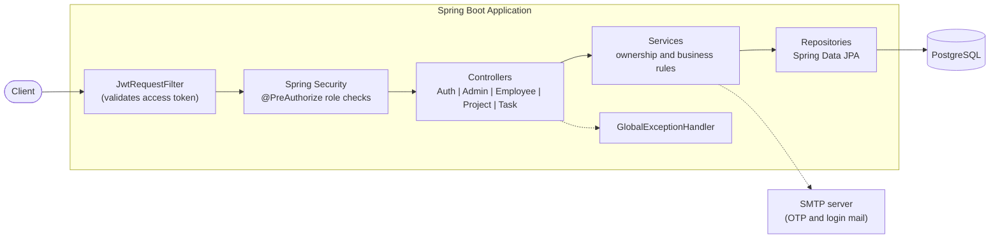
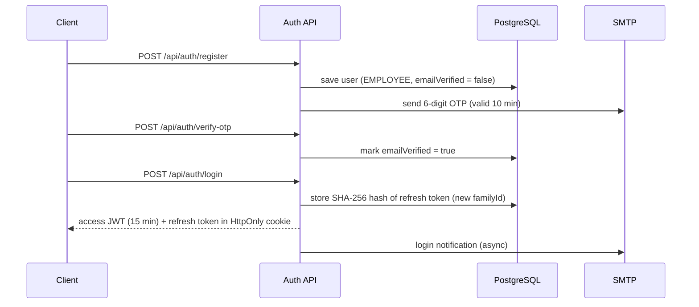
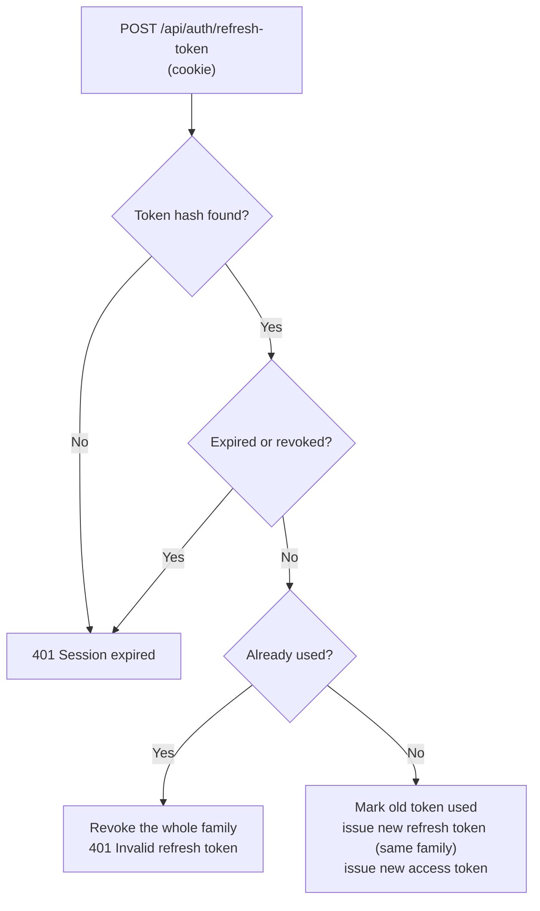
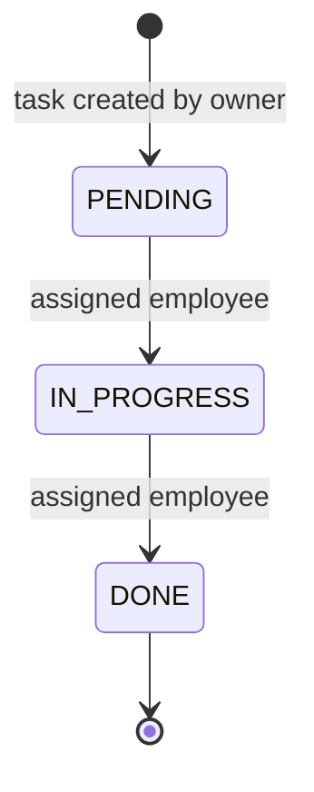
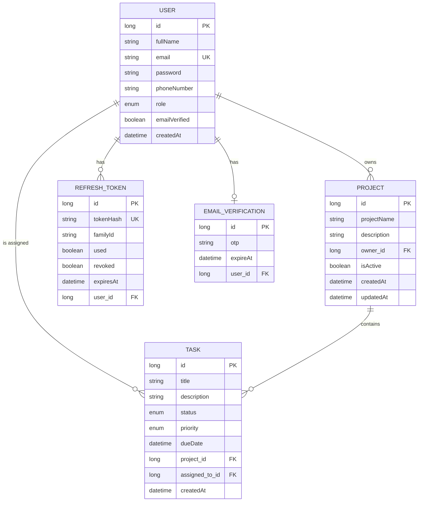

# 📋 Task Management API
 
A role-based **project and task management backend** built with Java and Spring Boot. Owners create projects and assign tasks, employees move their tasks through a fixed status flow, and an admin controls who becomes an owner. Authentication uses email OTP verification, short-lived JWT access tokens and rotating refresh tokens.
 
> **Scope:** this is a learning project built to practise REST design, Spring Security, JPA relationships and unit testing. It is well structured, but it is **not production-hardened** (see [Known Limitations](#-known-limitations)).
 
---
 
## 📑 Table of Contents
 
- [Features](#-features)
- [Tech Stack](#-tech-stack)
- [Roles and Permissions](#-roles-and-permissions)
- [Architecture](#-architecture)
- [Key Flows](#-key-flows)
- [Database Design](#-database-design)
- [API Reference](#-api-reference)
- [Getting Started](#-getting-started)
- [Testing](#-testing)
- [Project Structure](#-project-structure)
- [Known Limitations](#-known-limitations)
- [Author](#-author)
---
 
## ✨ Features
 
### Authentication and accounts
- Registration with **email OTP verification** (6-digit code from `SecureRandom`, valid for 10 minutes) and OTP resend
- Login allowed only for verified accounts; passwords hashed with **BCrypt**
- **JWT access token** (HS256, 15 minutes) carrying the user's email and role
- **Refresh token rotation:** random UUID, stored only as a **SHA-256 hash**, 7-day expiry, sent in an **HttpOnly cookie**
- **Reuse detection:** presenting an already-used refresh token revokes the whole token family
- Row lock (`PESSIMISTIC_WRITE`) while a refresh token is validated, so two parallel refresh calls cannot both succeed
- Login notification email, sent asynchronously
### Role-based access
- Three roles: `ROLE_EMPLOYEE`, `ROLE_OWNER`, `ROLE_ADMIN`
- Method-level security with `@PreAuthorize`, plus ownership checks inside the services
- **Admin account is seeded** at startup from configuration (only if no verified admin exists)
- Admin promotes employees to owners
### Projects and tasks
- Owners create, view, update and **soft-delete** their own projects
- Owners create tasks inside their projects and assign them to **verified employees**
- Tasks have a title, description, priority (`LOW`, `MEDIUM`, `HIGH`), a future due date and a status
- **Strict status workflow:** `PENDING` → `IN_PROGRESS` → `DONE`, and only the assigned employee can move it
- **Paginated** task listing per project, for the project owner or an employee who has a task in it
- Employees see their own tasks through a dedicated endpoint
### Quality
- Request validation with Jakarta Validation (including an Indian phone-number pattern)
- Central `@RestControllerAdvice` that maps exceptions to proper HTTP status codes
- Unit tests with JUnit 5 and Mockito for the project and task services
---
 
## 🛠️ Tech Stack
 
| Category | Technology |
|----------|------------|
| Language | Java 17 |
| Framework | Spring Boot 4.1.0 (Spring MVC, Spring Data JPA, Spring Security, Spring Validation, Spring Mail) |
| Database | PostgreSQL |
| Authentication | JWT ([jjwt](https://github.com/jwtk/jjwt) 0.12.6), BCrypt |
| Boilerplate | Lombok |
| Testing | JUnit 5, Mockito |
| Build tool | Maven (Maven Wrapper included) |
 
---
 
## 🔐 Roles and Permissions
 
| Action | Employee | Owner | Admin |
|--------|:--------:|:-----:|:-----:|
| Register, verify OTP, log in | ✅ | ✅ | ✅ |
| List verified employees | - | ✅ | ✅ |
| Promote an employee to owner | - | - | ✅ |
| Create / update / delete own projects | - | ✅ | - |
| Create or delete tasks in own projects | - | ✅ | - |
| Update status of a task assigned to them | ✅ | - | - |
| View tasks of a project | ✅ (if assigned a task in it) | ✅ (own project) | - |
| View own assigned tasks | ✅ | - | - |
 
New users always register as **employees**. Owners are created by the admin, and the admin account itself is created by the seeder.
 
---
 
## 🏗️ Architecture
 

 
**Layering:** `Controller → Service → Repository`. Role checks happen twice on purpose: `@PreAuthorize` at the controller, and an ownership or role check inside the service, so the rules still hold if a service is called from somewhere else.
 
---
 
## 🔄 Key Flows
 
### Registration and login
 

 
### Refresh token rotation
 

 
### Task status workflow
 

 
Any other transition (for example `PENDING` → `DONE`, or changing a `DONE` task) is rejected with `400 Bad Request`.
 
---
 
## 🗄️ Database Design
 

 
Projects use a soft delete (`isActive = false`). Tasks are deleted permanently.
 
---
 
## 🔌 API Reference
 
Base URL: `http://localhost:8080`. Protected endpoints need `Authorization: Bearer <accessToken>`.
 
### Auth: `/api/auth` (public)
 
| Method | Endpoint | Description | Body |
|--------|----------|-------------|------|
| `POST` | `/register` | Create an employee account and send an OTP | `fullName`, `email`, `phoneNumber`, `password` (min 8) |
| `POST` | `/verify-otp` | Verify the email | `email`, `otp` |
| `POST` | `/resend-otp` | Send a new OTP | `email` |
| `POST` | `/login` | Log in; sets the `refreshToken` cookie | `email`, `password` |
| `POST` | `/refresh-token` | Rotate the refresh token, get a new access token | `refreshToken` cookie |
 
### Admin: `/api/admin` (`ADMIN`)
 
| Method | Endpoint | Description |
|--------|----------|-------------|
| `GET` | `/` | List verified employees |
| `PUT` | `/{employeeId}` | Promote a user to owner |
 
### Employees: `/api/employee` (`OWNER`)
 
| Method | Endpoint | Description |
|--------|----------|-------------|
| `GET` | `/` | List verified employees (to pick an assignee) |
 
### Projects: `/api/project` (`OWNER`)
 
| Method | Endpoint | Description | Body |
|--------|----------|-------------|------|
| `POST` | `/create-project` | Create a project | `name`, `description` |
| `GET` | `/my-projects` | List your active projects | - |
| `GET` | `/{projectId}` | Get one of your projects | - |
| `PUT` | `/{projectId}` | Update a project | `name`, `description` |
| `DELETE` | `/{projectId}` | Soft-delete a project | - |
 
### Tasks: `/api/task`
 
| Method | Endpoint | Who | Description | Body |
|--------|----------|-----|-------------|------|
| `POST` | `/{projectId}/create-task` | Owner of the project | Create and assign a task | `title`, `description`, `priority`, `dueDate`, `assignedToId` |
| `PATCH` | `/{taskId}/status` | Assigned employee | Move the task forward one step | `taskStatus` |
| `GET` | `/project/{projectId}` | Project owner, or an employee with a task in it | Paginated tasks (`?page=0&size=10`) | - |
| `GET` | `/my-task` | Employee | Your assigned tasks | - |
| `DELETE` | `/{taskId}` | Owner of the project | Delete a task | - |
 
### Example requests
 
```bash
# Register, then verify with the OTP from your email
curl -X POST http://localhost:8080/api/auth/register \
  -H "Content-Type: application/json" \
  -d '{"fullName":"Asha Verma","email":"asha@example.com","phoneNumber":"9876543210","password":"StrongPass123"}'
 
curl -X POST http://localhost:8080/api/auth/verify-otp \
  -H "Content-Type: application/json" \
  -d '{"email":"asha@example.com","otp":"123456"}'
 
# Login (-c saves the refresh cookie, -b sends it later)
curl -c cookies.txt -X POST http://localhost:8080/api/auth/login \
  -H "Content-Type: application/json" \
  -d '{"email":"asha@example.com","password":"StrongPass123"}'
 
curl -b cookies.txt -X POST http://localhost:8080/api/auth/refresh-token
```
 
```bash
# As an owner: create a project, then assign a task
curl -X POST http://localhost:8080/api/project/create-project \
  -H "Authorization: Bearer <ownerAccessToken>" \
  -H "Content-Type: application/json" \
  -d '{"name":"Website Redesign","description":"New landing page"}'
 
curl -X POST http://localhost:8080/api/task/1/create-task \
  -H "Authorization: Bearer <ownerAccessToken>" \
  -H "Content-Type: application/json" \
  -d '{"title":"Design hero section","description":"Figma first","priority":"HIGH","dueDate":"2026-12-31T18:00:00","assignedToId":2}'
 
# As the assigned employee: start the task
curl -X PATCH http://localhost:8080/api/task/1/status \
  -H "Authorization: Bearer <employeeAccessToken>" \
  -H "Content-Type: application/json" \
  -d '{"taskStatus":"IN_PROGRESS"}'
```
 
### Error responses
 
| Status | When |
|:------:|------|
| `400` | Validation failure, invalid status transition, expired OTP, unverified assignee |
| `401` | Wrong credentials, unverified account, invalid or expired refresh token |
| `403` | Authenticated, but not allowed (wrong role, or not the owner or assignee) |
| `404` | User, project, task or employee not found |
| `409` | Email already registered, user already an owner, account already verified |
 
---
 
## 🚀 Getting Started
 
### Prerequisites
 
- Java 17
- PostgreSQL
- An SMTP account for the OTP and login emails (for Gmail, use an **app password**)
### 1. Clone
 
```bash
git clone https://github.com/TusharPandeydev/Task-Management.git
cd Task-Management
```
 
 ### 2. Configure
 
`application.properties` is git-ignored, so create `src/main/resources/application.properties` yourself. Secrets come from environment variables.
 
```properties
spring.datasource.url=jdbc:postgresql://localhost:5432/taskdb
spring.datasource.username=${DB_USERNAME}
spring.datasource.password=${DB_PASSWORD}
spring.jpa.hibernate.ddl-auto=update
 
spring.mail.host=smtp.gmail.com
spring.mail.port=587
spring.mail.username=${MAIL_USERNAME}
spring.mail.password=${MAIL_PASSWORD}
spring.mail.properties.mail.smtp.auth=true
spring.mail.properties.mail.smtp.starttls.enable=true
 
jwt.secret=${JWT_SECRET}
 
app.admin.name=Admin
app.admin.email=${ADMIN_EMAIL}
app.admin.password=${ADMIN_PASSWORD}
```
 
| Variable | Description |
|----------|-------------|
| `DB_USERNAME`, `DB_PASSWORD` | PostgreSQL credentials |
| `MAIL_USERNAME`, `MAIL_PASSWORD` | SMTP login |
| `JWT_SECRET` | Random string of **at least 32 characters** (for example `openssl rand -base64 48`) |
| `ADMIN_EMAIL`, `ADMIN_PASSWORD` | Credentials of the seeded admin account |
 
### 4. Run
 
```bash
./mvnw spring-boot:run          # Mac / Linux
mvnw.cmd spring-boot:run        # Windows
```
 
The API starts on `http://localhost:8080`. On first start the admin account is created automatically.
 
### 5. Try the whole flow
 
1. Register two users and verify both with the OTP emails
2. Log in as the **admin** and call `PUT /api/admin/{userId}` to promote the first user to owner
3. Log in again as that user (the role is read from the database, but the old access token still carries the old role until it expires) and create a project
4. Create a task assigned to the second user, log in as them and move it `PENDING` → `IN_PROGRESS` → `DONE`
> Never commit real secrets. Keep them in environment variables or a git-ignored file.
 
---
 
## 🧪 Testing
 
```bash
./mvnw test
```
 
Unit tests use **JUnit 5 and Mockito**, so no database or mail server is needed. They cover:
 
| Service | Scenarios |
|---------|-----------|
| `ProjectService` | create a project; list, view, update and delete as owner; reject non-owners on view, update and delete |
| `TaskService` | create a task as owner; reject a non-owner; reject an unverified employee; `PENDING` → `IN_PROGRESS`; `IN_PROGRESS` → `DONE`; reject `PENDING` → `DONE`; reject the wrong employee; reject project task listing without access |
 
---
 
## 📂 Project Structure
 
```
src/main/java/com/campusconnect/
├── CampusConnectApplication.java
└── campus/
    ├── Configuration/   # SecurityConfig, JwtRequestFilter
    ├── Controller/      # Auth, Admin, Employee, Project, Task
    ├── Dto/             # Request and Response objects
    ├── Enum/            # Role, TaskStatus, TaskPriority
    ├── Exception/       # Custom exceptions + GlobalExceptionHandler
    ├── Model/           # JPA entities
    ├── Repositories/    # Spring Data JPA repositories
    ├── Seeder/          # AdminSeeder
    └── Service/         # Business logic, JWT, OTP email, refresh tokens
 
src/test/java/com/campusconnect/service/   # Mockito unit tests
```
 
---
 
## ⚠️ Known Limitations
 
This project is not production-hardened. The main gaps:
 
- **No rate limiting or attempt limits.** OTP verification and login can be brute-forced.
- **OTPs are stored in plain text** in the database.
- **No logout endpoint**, and refresh tokens are not revoked on logout. Access tokens cannot be revoked before they expire.
- **Refresh cookie is `Secure=false`** for local development. It must be `true` behind HTTPS.
- **Sender email is hard-coded** in `EmailVerificationService`; it should come from configuration. Registration sends the OTP email synchronously and only logs mail errors.
- **Role changes need a new login.** The access token carries the role at issue time.
- **Task listing ignores soft-deleted projects**, so tasks of a deleted project can still be fetched by id.
- **Admin promotion is unrestricted:** the admin can promote any user, including an unverified one.
- **No password reset or change flow.**
- **Table names contain hyphens** (`project-db`, `Task-db`), which PostgreSQL does not accept unquoted; rename them to underscores on a fresh database.
---
 
## 👤 Author
 
**Tushar Pandey**
 
- GitHub: [@TusharPandeydev](https://github.com/TusharPandeydev
